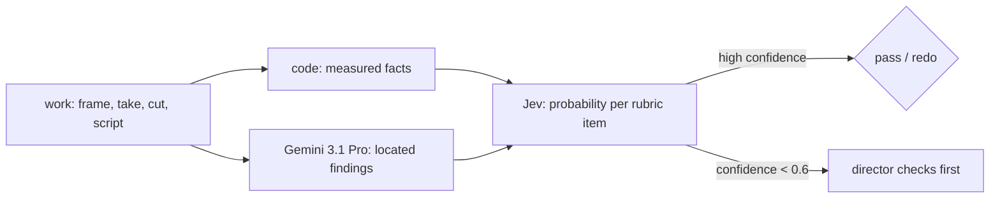

# Critic models: Gemini 3.1 Pro and Jev

Each tool does the part it is good at. Code measures the numbers (shot lengths, loudness, colour distance, beat timing). **Gemini 3.1 Pro** sees and hears, and writes located findings. **Jev** reads both as text and scores each rubric item or craft rule with a calibrated probability. Muse, as director, decides what the critics cannot. Method: skills `video-critic` and `crew`.

## Gemini 3.1 Pro watches with sound
- **Route:** fal `openrouter/router/video` with `google/gemini-3.1-pro-preview` on `FAL_KEY`, so no Google key is needed.
- **`reasoning: true` is mandatory.** Without it the queue returns 400 "Reasoning is mandatory for this endpoint and cannot be disabled."
- **Cost:** a 3:50 clip at 480p used ~21.5k prompt tokens and cost $0.105 in 69 s.
- **Privacy:** send the studio's own cuts inline as a data URI. A fal storage upload makes a public URL ([[generation-field-notes]], delivery and fal CDN privacy), so upload only clips that are already public.
- **A blind critique works.** On [[lab-cinematic]] v1, with no hint, it named both of the principal's notes (medium-speed movement, recited dialogue), plus weak lip-sync and dry voices. On video it correctly failed a motion test at 4/10: a plane floating toward the camera at medium speed.
- **It samples sparsely.** A 30 s clip at 360p used only ~3k prompt tokens. Timecodes ran ~1 s off and it misheard a name.

### Where it fails
- **One overall score is unreliable.** It gave a script a uniform 10/10 with no defects, called correct screen directions wrong, and missed changed windows. Use a checklist (below) and Jev, not the score, as the gate.
- **It judges only what its context lets it check.** Without the set's per-camera side map it never flagged a pilot's window on the wrong side of the frame. With the map, it scored that frame 0/10 on geography and the fixed frame 9.
- **It missed a set rebuilt between frames** (different cockpit windows) while it caught a mic on the wrong cheek and a missing visor. It cannot be the only guard of set continuity; compare architecture side by side.
- **It misattributes speakers in long clips.** On a 60 s cut it judged a listening face as bad lip-sync while another character spoke over the radio.
- **It invents defects.** On a design spec, both of its major defects were wrong: one was a director decision already in the script, the other misread a mirrored upward-looking camera. On a frame, its "melted fingers" were not visible at full size. Give it the current script and the director's decisions, and confirm each claim on frames, full-size crops or the waveform before any redo.
- **Its sound notes are weak and its scores do not move with fixes** ([[splat-world-01]]). Three passes on the same prompt: it said "no sound design" twice while transition SFX were in the mix (they were 10 dB too loud, a fault it did not hear), and it called the camera "too slow in the crater" in one pass and "the same speed all the way" in the next. A pass with five measured fixes kept the same 5.5 overall. The hook note (dark first second) was real both times and luminance confirmed it. Act on a note only when a measurement confirms it: frame luminance, clipped-pixel share, frame-to-frame change, ebur128 momentary loudness.

### Checklists beat one overall score
- **The canon check:** atomic yes/no questions written from each spec ("2 roof windows? 4-point harness? mic on the outer side? canyon behind, not forest?"), asked with the master images beside the frame. It runs on fal `openrouter/router/vision` with the same model, for about $0.05 a frame. A maker runs it before recording and fixes every "no".
- **Calibrated on 4 known-bad and 4 known-good frames,** it failed every bad frame for the right reason and caught a missing handle on a frame the director had fixed by hand.
- **Items must match the spec word for word.** "No green forest" failed a correct frame of dark burning conifers until it was reworded. A "looks AI-made" item fired on every frame, so it is a warning, not a blocker.
- **Canon is not the brief.** A frame that copied a reference image passed every canon item but lost the shot's own read (smoke, a jolt, thrown heads). Add the shot's brief items to its checklist.

## Jev (TypeSafe) judges
- **What it is:** a text-only judge model. It cannot see or hear. It answers bounded questions with a probability distribution and a confidence per question, in under a second, for well under a cent per gate.
- **Access:** the key is `JEV_API_KEY` (the bundled typesafe plugin expects `TYPESAFE_API_KEY`). Calls need TypeSafe credits; without them it returns `billing_error: no available TypeSafe API credits`.
- **It inherits Gemini's wrong claims** (it rated both invented defects 0.66–0.70 likely real), but its confidence on those items was low (0.44–0.47). So confidence under 0.6 sends the item to the director before any redo.
- **The craft rulebook** (the principal's idea): each piece of craft becomes one short, testable rule, for example "silence is the threat: no score under the no-answer beat". Rules come from the principal's notes, reference studies and the skills. On a 60 s script it made 121 judgments in 0.6 s and found a real gap: the fast exterior shots gave no screen direction. It was not confident on whether domain jargon is real, so that stays with specialist reviewers.

Related: [[masters-of-the-air-case]], [[gossip-goblin-trailer-case]], [[anti-slop]].
